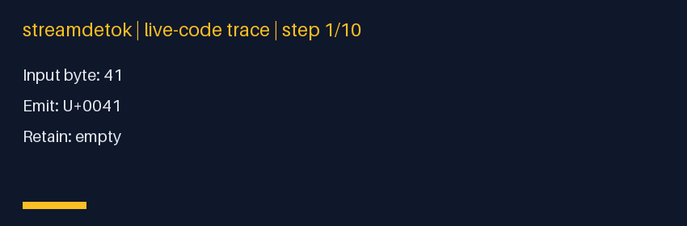
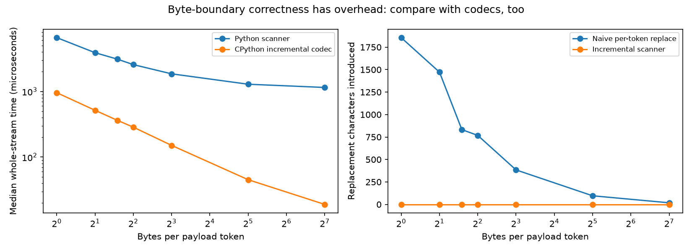
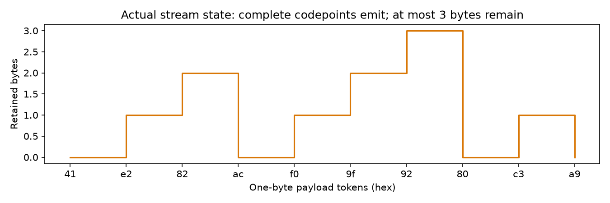

# streamdetok: the byte boundary is not the character boundary

A payload token may carry `e2`, followed by another carrying `82 ac`. Decoding
those independently emits replacement characters; retaining the viable tail emits
`€` exactly when its final byte arrives. **That is the problem solved here.** This
is an incremental UTF-8 decoder for byte-payload token IDs, not a complete
context-sensitive tokenizer detokenizer.



## Start with a five-line stream

```python
from streamdetok import Detok, Vocab

stream = Detok(Vocab([b"\xe2", b"\x82\xac", b"!"]))
assert stream.push(0) == ""
assert stream.push(1) == "€"
assert stream.push(2) == "!"
assert stream.flush() == ""
```

`Vocab` copies payloads into an immutable tuple. Token IDs index those payloads;
negative or out-of-range IDs raise `IndexError`. Empty payloads are harmless.
`push` emits every complete valid codepoint in the current buffer. A viable
incomplete tail remains, at most three bytes after each call. This is a codepoint
boundary, not a grapheme boundary: combining accents and emoji sequences can span
emissions. There is no vocabulary-first-byte lookahead because UTF-8 codepoint
completion does not need it.

## Recovery policy — explicitly lossy

The scanner enforces shortest-form UTF-8, continuation positions, exclusion of
surrogates, and the U+10FFFF upper bound. Invalid spans are **reported and dropped**;
they are not repaired and do not produce synthetic U+FFFD. Valid input containing
an actual U+FFFD is preserved, so “zero replacements” is not a blanket text claim.

| Input bytes | Action |
|---|---|
| `e2 82` | retain a viable two-byte tail |
| `c0 80` | report/drop overlong encoding |
| `ed a0 80` | report/drop surrogate encoding |
| `f4 90 80 80` | report/drop out-of-range codepoint |
| viable tail at EOS | report `unterminated-at-eos`, drop tail |

`flush(eos=False)` preserves the tail. `flush()` finalizes it and clears pending
bytes. `dropped` counts report events, while `dropped_bytes` counts actual removed
bytes. Report grouping can depend on payload chunking; output and dropped-byte
totals are chunk-invariant under the tested recovery policy. Reports accumulate
for the lifetime of the object, so **only the retained byte tail**, not all memory,
is bounded by three. Large individual payloads still need proportional work and
temporary storage. `scan()` returns a valid-byte **count**, not a prefix offset
when invalid bytes are interspersed.

### A useful discrepancy with CPython

Valid-prefix state and per-push output are checked against incremental `codecs`.
CPython defers rejecting a two-byte `ED A0..BF` surrogate prefix until another
byte or EOS. This scanner reports it immediately because no extension can make
it valid. The tests pin that narrow pending-state difference; both emit the same
text and agree with UTF-8 `errors="ignore"` recovery. This is not a claim that
invalid-stream error reporting happens at exactly the same time as CPython.

## Measure correctness *and* the cost

The benchmark repeatedly streams 2,880 bytes of mixed Latin, Devanagari, combining
marks, symbols and emoji at seven fixed payload sizes. The independent baseline
is CPython's incremental UTF-8 codec; naive per-token replacement is a deliberately
incorrect control, not the strongest implementation to beat.



At one byte per token, the checked run produced **1,856 introduced replacement
characters** in the naive control and **zero** in the custom and codec paths.
Whole-stream median times were **6.60 ms custom** versus **0.956 ms codecs**, after
two warmups and seven measured repetitions. The Python scanner is slower; its
value here is inspectable state and explicit reports, not performance superiority.
The [receipt](receipts/receipt.json) includes every timing sample, environment,
source digest, the valid byte trace and malformed-input recovery examples.



## Reproduction workbench

Use this local repository rather than installing an identically named PyPI package:

```bash
python3 -m venv .venv
. .venv/bin/activate
python -m pip install -e '.[dev,viz]'
python -m pytest -q
ruff check .
ruff format --check .
mypy
python benchmarks/run.py
python demos/make_figures.py
python -m build
```

All scripts resolve artifacts relative to the checkout. `demos/demo.py` is a
compatibility runner for the benchmark. The GitHub Actions workflow exercises
CPU lint, type checks, tests, measurements, visuals and packaging.

## Audit coverage and non-goals

18 tests include **65,792 exhaustive one-/two-byte scanner inputs**, every one of
128 partitions of `A€💀`, 1,500 seeded malformed streams, 300 random Unicode texts
streamed one byte at a time, strict-prefix comparison, EOS behavior, and historical
split examples. Toy-vocabulary tests select payloads by content, not hardcoded
indices. The earlier lead-bit-only scanner accepted overlong, surrogate and
out-of-range sequences and could crash during final decode; those cases now have
regression tests. Nonfinal flush previously discarded the pending tail.

No tokenizer assets are downloaded. Byte BPE and byte fallback mappings may be
adapted only when payload concatenation is the correct decoding model. SentencePiece
space markers, cleanup rules, normalization, special/stop token stripping,
context-dependent rendering, and cumulative token-to-text revision are outside
this API. Do not apply the no-revision argument to such tokenizers without a
separate adapter and its own differential tests.

- `streamdetok/core.py`: strict scanner and `UTF8` inspection API.
- `streamdetok/detok.py`: token lookup, tail retention and reporting.
- `tests/test_codecs.py`: exhaustive/differential reference checks.
- [Standalone architecture](assets/architecture.svg) / [offline HTML](assets/architecture.html).

Standards and reference behavior: [RFC 3629](https://www.rfc-editor.org/rfc/rfc3629)
and Python's [incremental codecs](https://docs.python.org/3/library/codecs.html#incremental-encoding-and-decoding).
MIT licensed; see [LICENSE](LICENSE).
